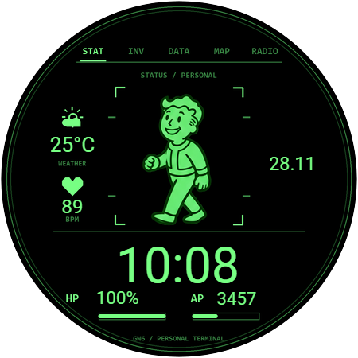

# Pip-Boy GW6 

Зелёный ретроинтерфейс для часов на Wear OS, собранный в Samsung Watch Face Studio.

**[Скачать проект Watch Face Studio (.wfs)](https://github.com/vvmutee/pipboy-gw6-watchface/raw/refs/heads/main/PipBoy_GW6.wfs)** · **[Установка на часы](INSTALL_RU.md)**

## Возможности

- Цифровое время, дата, пульс и шаги.
- HP — заряд батареи часов; AP — выполнение цели по шагам.
- Температура в °C через погодные теги WFS; при отсутствии данных — `--°C`.
- Персонаж с 16 фазами ходьбы, воспроизведение при активном экране.
- Упрощённый AOD с часами и минутами.
- Нижние полосы индикаторов помещаются внутри круглой рамки.

## Совместимость

Проверено автором на **Samsung Galaxy Watch6 с Wear OS 6 / One UI Watch 8**. Для прямых погодных тегов необходим **Wear OS 5 или новее**. Другие модели часов отдельно не проверялись. Размер логического холста — 450×450.

Открывай проект в актуальной [Samsung Watch Face Studio](https://developer.samsung.com/watch-face-studio/download.html). Файл `.wfs` содержит встроенные изображения; отдельно собирать ассеты не требуется. Это исходный проект, не APK: установка выполняется через **Run on Device**.

Значения на превью демонстрационные. Данные на часах зависят от разрешений, датчиков и доступности погоды. Статичная иконка погоды не меняется вместе с осадками. Длительность работы от батареи отдельно не измерялась.

## Файлы

| Файл | Назначение |
|---|---|
| `PipBoy_GW6.wfs` | Финальный проект с вложенными ассетами |
| `INSTALL_RU.md` | Пошаговая установка по Wi-Fi |
| `preview.png` | Предпросмотр из сохранённого проекта WFS |
| `aod-preview.png` | Иллюстрация режима AOD |
| `animation-preview.gif` | Увеличенное превью ходьбы на чёрном фоне |
| `validation.json` | Проверка целостности экспортированной копии |
| `NOTICE.md` | Происхождение материалов и сведения о фанатском проекте |

В копии для распространения удалены локальные пути и сохранённые данные подписи. Ключи подписи не включены. При первой сборке используй собственный ключ WFS и сохраняй его для будущих обновлений.

Неофициальный фанатский проект. Не связан с Bethesda, ZeniMax или Samsung и не одобрен ими. Подробнее — [NOTICE.md](NOTICE.md).
